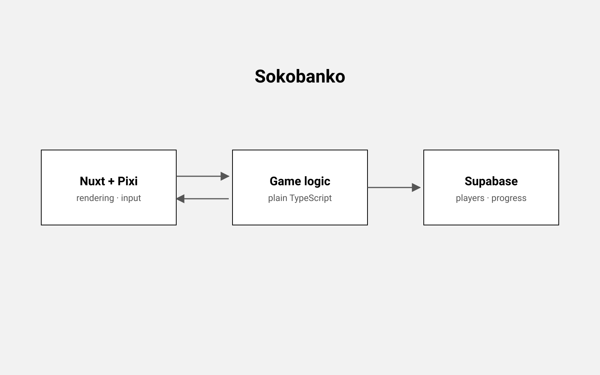

## Why I built it

To build a complete game end to end: rendering, game logic, and a backend for players and progress.

## Architecture

A Nuxt app renders the game with Pixi. Game logic is plain TypeScript, separate from rendering. Supabase stores players and their progress.

## Key decisions

### Game logic separate from rendering

The rules run without Pixi, so they're easy to test and reason about.

### Supabase for the backend

Auth and storage out of the box, so the time went into the game.

## What I'd do next

A level editor, and sharing levels with other players.
