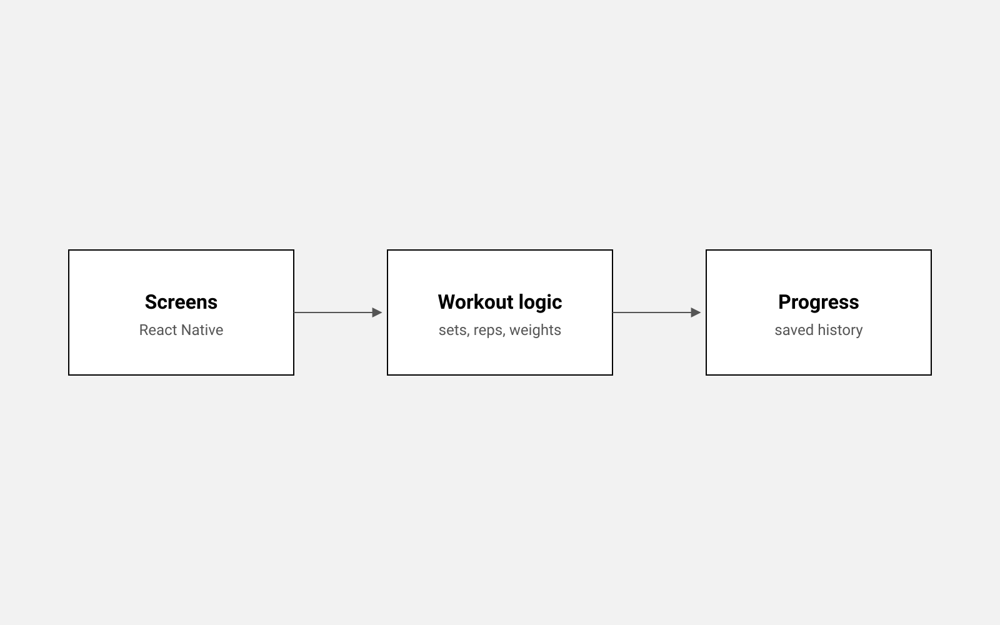

## Why I built it

A StrongLifts-style 5×5 tracker of my own: a simple workout plan, logged set by set, with the weights going up over time.

## Architecture

A React Native app. Workout logic, the sets, reps and next weights, sits apart from the screens, and progress is saved after every set.

## Key decisions

### Logic apart from the screens

The rules for sets and weight increases run without the UI, so they're easy to test.

## What I'd do next

Charts for progress over time, and more programs than 5×5.
